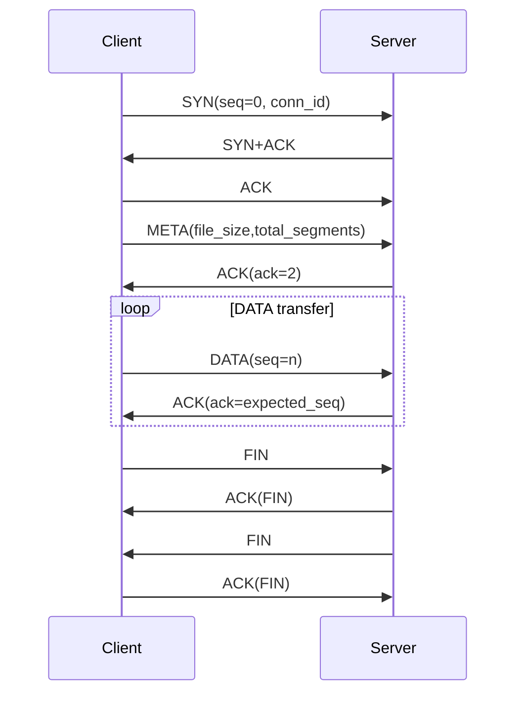
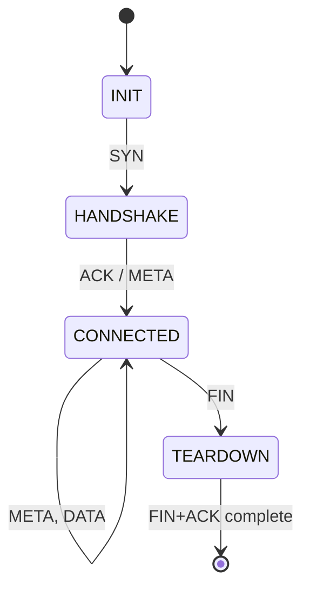
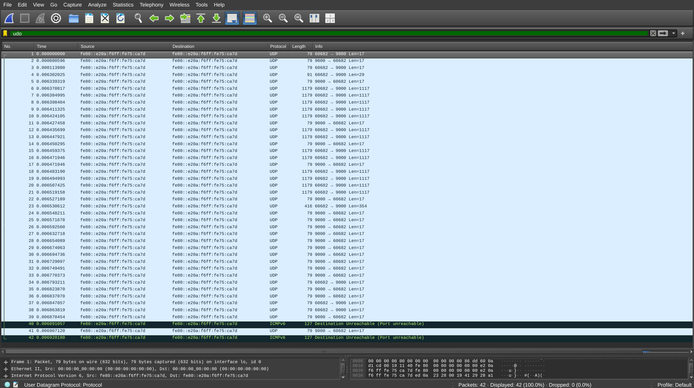

# IPK Project 2 – Reliable Data Transfer over UDP (`ipk-rdt`)

## Úvod

Projekt implementuje vlastní spolehlivý přenos bajtového proudu nad UDP v jednom binárním souboru:

- **client** (`-c`) odesílá data ze souboru nebo `stdin`
- **server** (`-s`) přijímá data do souboru nebo na `stdout`

Řešení podporuje IPv4 i IPv6, používá explicitní navázání/ukončení relace, kumulativní ACK, retransmise a kontrolu integrity přes checksum.

---

## Kompilace a spuštění

### Požadavky

- Linux / POSIX prostředí
- `gcc`
- `python3` (pro testy)

### Build

```bash
make
```

Výstupní binárka:

```bash
./ipk-rdt
```

### Testy

```bash
make test
```

---

## CLI

### Server

```bash
./ipk-rdt -s -p PORT [-a ADDRESS] [-o OUTPUT] [-w TIMEOUT] [-v]
```

### Client

```bash
./ipk-rdt -c -a HOST -p PORT [-i INPUT] [-w TIMEOUT] [-v]
```

### Parametry

- `-s` server mode
- `-c` client mode
- `-a` adresa hosta / bind adresa serveru
- `-p` UDP port (povinný)
- `-i` vstup (`-` = stdin)
- `-o` výstup (`-` = stdout)
- `-w` timeout v sekundách (default `1`)
- `-v` verbose debug logy na `stderr`
- `-h`, `--help` nápověda

---

## Návrh protokolu

### Formát hlavičky

Implementace používá pevnou hlavičku `rdt_header_t` (`src/protocol.h`), velikost **17 B**:

| Pole | Typ | Velikost |
|---|---|---|
| `conn_id` | `uint32_t` | 4 B |
| `seq` | `uint32_t` | 4 B |
| `ack` | `uint32_t` | 4 B |
| `len` | `uint16_t` | 2 B |
| `flags` | `uint8_t` | 1 B |
| `checksum` | `uint16_t` | 2 B |

Flagy:

- `SYN` (`0x01`)
- `ACK` (`0x02`)
- `FIN` (`0x04`)
- `DATA` (`0x08`)
- `META` (`0x10`)

### Payload limity

- `MAX_PAYLOAD_SIZE = 1100`
- `RDT_HEADER_SIZE = 17`
- maximum jednoho UDP payloadu = **1117 B** (splňuje limit 1200 B)

### Checksum

Checksum je 16bit internet checksum (RFC1071 styl) přes hlavičku i payload.  
Paket s chybným checksumem, špatnou délkou nebo nevalidními flagy je ignorován.

---

## Průběh relace (establishment, transfer, teardown)

### 1) Navázání spojení (3-way)

1. Client -> Server: `SYN` (`seq=0`)
2. Server -> Client: `SYN+ACK`
3. Client -> Server: `ACK`

### 2) META

Client po handshake odešle `META` se strukturou:

- `file_size` (`uint64_t`, network order)
- `total_segments` (`uint32_t`, network order)

Server potvrdí `ACK` s `ack=2`.

### 3) DATA (Go-Back-N)

- DATA segmenty běží od `seq=2`
- client posílá oknem (`WINDOW_SIZE=16`)
- server udržuje `expected_seq` a posílá kumulativní ACK

### 4) Ukončení

1. Client -> Server: `FIN`
2. Server -> Client: `ACK` na FIN
3. Server -> Client: vlastní `FIN`
4. Client -> Server: finální `ACK`

---

## Strategie sekvencování, ACK a retransmisí

### Sekvence

- `seq=0` handshake
- `seq=1` META
- `seq>=2` DATA

### ACK strategie

- kumulativní ACK: `ack` = nejbližší očekávané `seq`
- out-of-order/duplicate DATA server nezapisuje a vrací aktuální kumulativní ACK

### Retransmise a timeouty

Client čeká na příchozí paket přes `select()` s timeoutem `-w`.  
Pokud timeout vyprší:

- během DATA fáze nastaví `next = base` (Go-Back-N retransmit)
- při dlouhodobém nulovém progressu ukončí přenos chybou

V aktuální jednoduché variantě je ukončení při **3 po sobě jdoucích timeout intervalech bez progressu** (`MAX_TIMEOUTS_WITHOUT_PROGRESS = 3`).

---

## Ochrana proti duplicitám, out-of-order a cizím paketům

- `conn_id` je náhodně generované na klientovi; server po navázání akceptuje jen tento `conn_id`
- duplicitní/out-of-order DATA server nezapisuje do výstupu
- před META se DATA ignorují
- nevalidní/poškozené/truncated jednotky se zahazují bez pádu aplikace

---

## Architektura (moduly)

- `src/main.c` – CLI, validace argumentů, dispatch client/server
- `src/protocol.{h,c}` – serializace/deserializace, checksum, validace paketů
- `src/client.c` – handshake, META, Go-Back-N sender, teardown
- `src/server.c` – bind, handshake state machine, receiver + ACK, teardown

### UML – sekvenční diagram



### UML – stavový diagram serveru



---

## Testování

Automatické testy (`tests/test_all.py`) pokrývají:

- CLI validace
- kontrolu protokolových limitů (1200 B constraint)
- přenosové scénáře (IPv4/IPv6, file/stdin/stdout, empty input)
- robustnost na malformed traffic:
  - náhodné nevalidní UDP datagramy
  - chybný META
  - duplicitní a out-of-order DATA
  - checksum corruption
  - ukončení malformed session s non-zero návratovým kódem

---

## Wireshark – popis přenosu (k vloženému screenshotu)



**Ukázka kompletního IPv6 přenosu RDT nad UDP:**  
Pakety 1–3 realizují 3-way handshake (`SYN`, `SYN+ACK`, `ACK`).  
Paket 4 je `META` (29 B payload), paket 5 je ACK na META (`ack=2`).  
Pakety 6–23 jsou DATA segmenty (většina má délku 1117 B = 17 B hlavička + 1100 B data, poslední je kratší 354 B payload).  
Pakety 11, 14, 17, 22, 24–33 představují průběžné kumulativní ACK od serveru.  
Pakety 34–39 jsou teardown (`FIN/ACK/FIN/ACK`) s retransmisemi při ztrátě/zpoždění závěrečných zpráv.  
Pakety 40 a 42 (`ICMPv6 Destination Unreachable – Port unreachable`) vznikají po ukončení relace, kdy na již zavřený UDP port dorazí opožděný paket.

---

## Známá omezení

- implementace obsluhuje jednu relaci na běh serveru
- není řešeno resume po pádu procesu
- není implementované šifrování/autentizace

---

## Poznámka k využití AI

Při tvorbě části testů a dokumentace byly pro pomocné účely využity nástroje založené na AI (návrhy textů a struktury dokumentace, doporučení pro testovací scénáře). Konkrétně byl použit model GPT-5.2 od Github Copilota. Finální obsah byl zkontrolován a upraven autorem projektu.

---

## Zdroje

- https://www.geeksforgeeks.org/computer-networks/udp-client-server-using-connect-c-implementation/
- [RFC 1071: Computing the Internet Checksum](https://datatracker.ietf.org/doc/html/rfc1071)
